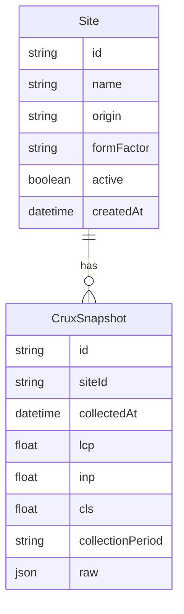

# Base VitalPass (Next.js + Prisma + CrUX)

## Contexto de producto
VitalPass (Best Worlds) mejora Core Web Vitals en Magento (módulo + cache + trabajo CLS). Esta app **monitorea** que un sitio no pierda performance después, consultando la **API de CrUX** y guardando histórico.

## Stack (decidido)
- **Next.js** (App Router) + TypeScript + Tailwind
- **Prisma** + **PostgreSQL** local vía **Docker Compose**
- **shadcn/ui** + **Zod**
- Scripts claros (`db:*`, `dev`, `lint`) y **`.env.example`**
- **AGENTS.md** + reglas Cursor para que la IA codee con convenciones fijas

Sin auth en esta base (se agrega después). Sin UI de marketing: shell mínimo de app + listado/detalle de sitios.

## Modelo de datos inicial



- `Site`: origen a monitorear (`https://example.com`), nombre, form factor CrUX (`PHONE`/`DESKTOP`), flag `active`
- `CruxSnapshot`: métricas clave (LCP, INP, CLS) + payload crudo de CrUX para auditoría

## Estructura del repo

```
/
├── prisma/schema.prisma
├── docker-compose.yml          # postgres
├── .env.example
├── AGENTS.md                   # convenciones para IA
├── src/
│   ├── app/                    # routes (sites list/detail)
│   ├── components/ui/          # shadcn
│   ├── lib/
│   │   ├── db.ts               # Prisma client singleton
│   │   ├── env.ts              # Zod-validated env
│   │   └── crux/               # client CrUX (fetch + parse)
│   └── server/                 # actions / queries tipadas
```

## Integración CrUX
- Cliente en `src/lib/crux/` que llama a la API oficial con `CRUX_API_KEY`
- Función tipada: input `origin` + `formFactor` → métricas normalizadas
- Server Action / route interna para “fetch now” y persistir `CruxSnapshot` (sin cron todavía; el job programado queda fuera de esta base)

## DX para IA
- `AGENTS.md`: stack, carpetas, “dónde poner queries/actions”, cómo correr DB, no inventar auth, patrones Prisma/Zod
- `.cursor/rules` breve: TypeScript estricto, Server Components por defecto, validar con Zod en boundaries
- Tipos generados por Prisma; env validado al boot

## Fuera de alcance (ahora)
- Auth / multi-tenant clientes
- Cron/scheduler de chequeos
- Dashboard fancy de charts (solo listado + último snapshot)
- Integración con el módulo Magento

## Pasos de implementación
1. `create-next-app` en el root (TS, App Router, Tailwind, ESLint)
2. Docker Compose Postgres + Prisma schema + migrate inicial
3. shadcn init + Zod + `lib/env.ts` + `lib/db.ts`
4. Cliente CrUX + Server Action de recolección
5. Páginas mínimas: lista de sites, detalle con historial de snapshots, form para alta de site
6. `AGENTS.md` + rule Cursor + README con `docker compose up`, `prisma migrate`, `npm run dev`
